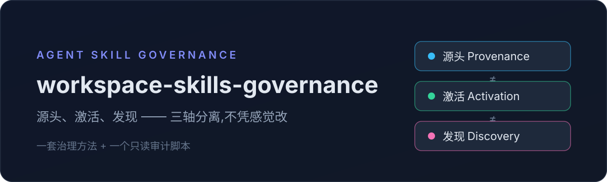
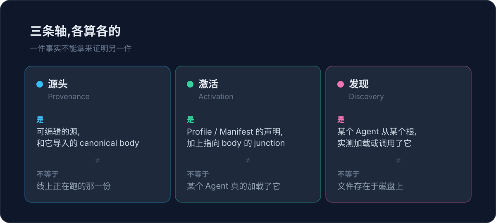

<div align="center">
  
</div>

# workspace-skills-governance

这个 Skill 把一组 Agent Skill 的源头、激活和运行时发现分成三件独立的事来治理，让人在升级、去重和迁移时不会凭感觉改坏。它是一套治理方法，外加一个只读的审计脚本。

## 价值

它帮同时维护 user、workspace、项目等多个作用域 Skill 的人，回答一句容易被糊弄过去的话：这个 Skill 现在到底激活没有、改哪一份才安全。它只提供方法和审计，不代替你工作区里的控制面脚本，也不替你写新的 Skill。

## 证据

当前版本是 1.3.0。本地证据：结构校验通过；多次真实治理任务按其流程收口，包括一次上游批量跟随升级(11 个 Skill 经过 preview 加回滚保护完成替换或判定不变)与数次旧基线验收退休。这些检查不能证明别人安装之后会得到同样的结果。没有安装量和用户数，这里就不写。

## 自然语言示例

你可以直接这样说:

- 「盘点这个 workspace 的 Skill，告诉我哪一份是 canonical。」
- 「治理这个 workspace 的 Skill，先只读盘点，不要改。」
- 「复用这份验收，检查某个 Skill 的旧版能否清理，先只预览。」
- 「跟着上游把这几个 Skill 升到最新标签，按门禁走。」

本地源新增轻量验收与旧基线清理流程：一个最小实际任务通过后，Agent 定向核查并预览单个旧包；只有明确删除授权才通过兼容的 `retire-body` 控制面执行。成功真正移除旧包，不永久转存、不强制追最新或另留 previous。例：「复用这份验收，检查 humanizer 旧版能否清理，先只预览。」本地源改动不等于现役 body 已部署或远端已发布。

## 机制

Agent 在涉及 Skill 的盘点、激活、升级、去重或迁移时读取它。它先盘点 Git 根、Agent 入口、body、registry、Profile 和消费者，再把源头、激活、发现三条轴分开记录，最后只通过已发现的控制面在 preview 之后落地，并留下恢复点。这里不展开目录结构。

<div align="center">
  
</div>

## 最短上手

你可以直接对 Agent 说:「治理这个 workspace 的 Skill，先只读盘点，不要改。」

安装命令:

```bash
npx skills add Jhyphlau/workspace-skills-governance
```

## 使用边界

这个仓库不做什么、需要什么前提，以及会影响「用不用」的失败方式。

- 没有控制面时：它保持只读，只给出盘点和一份建议的契约，不替这个工作区创建治理状态。
- 常见的失败方式：触发描述写得太窄时它不会自动介入；结构存在不等于运行时被发现，两者不能互相证明。

## 安装前提

- [ ] 已安装 Node.js 与 npx:`node --version && npx --version`
- [ ] 审计脚本需要 PowerShell(pwsh，或 Windows PowerShell 5.1)
- [ ] 升级、替换这类改动，需要工作区里存在兼容的控制面脚本(如 `manage-skills.ps1`)

## 验证

- 安装后发现性验证:`npx skills add Jhyphlau/workspace-skills-governance --list` 应列出本 Skill。
- 包结构校验：可用 qiaomu-meta-skill 工具链的 `validate_skill.py` 对本目录做结构校验。
- 运行时验证：审计脚本 `scripts/audit-workspace-skills.ps1` 为只读，可在目标工作区直接运行核对盘点输出。

## Troubleshooting

| 症状 | 可能原因 | 处理 |
| --- | --- | --- |
| 找不到 Skill | 安装源或名称错误 | 运行 `npx skills add Jhyphlau/workspace-skills-governance --list` 确认发现性 |
| 审计脚本报路径不存在 | 在非治理根目录直接引用了别人的控制面脚本 | 先盘点目标工作区自己的控制面，审计脚本保持只读 |
| 改动没有生效 | 源头改了但激活体未替换 | 源头、激活、发现是三件事，按 references/governance-model.md 分别核查 |
| Agent 没有按它行动 | 触发描述未命中或运行时发现缺失 | 结构存在不等于被发现，换自然语言显式触发并检查入口 |

## 许可证

许可证是 MIT，见 [LICENSE](LICENSE)。

## 深入阅读

- 治理模型与边界判定，见 [references/governance-model.md](references/governance-model.md)。
- 版本替换与回滚，见 [references/version-replacement.md](references/version-replacement.md)。
- 证据分级与收口契约，见 [references/verification.md](references/verification.md)。
- 本仓库是 Jhyphlau 的作品，正文没有借鉴上游实现。
